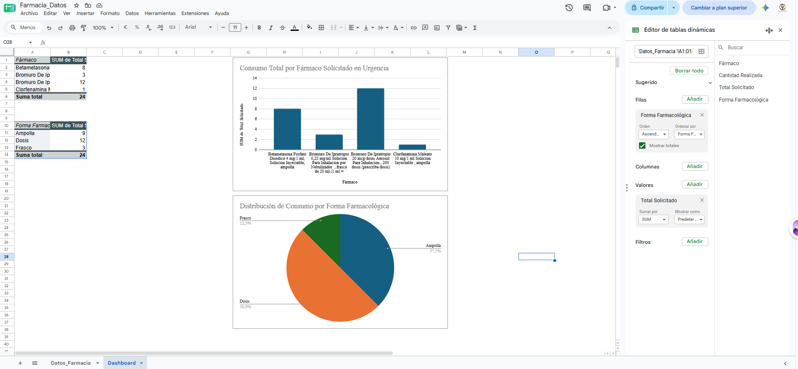

# analisis-consumo-farmacia-urgencia
# Análisis de Consumo y Dispensación Farmacéutica en Urgencias

## 🎯 Objetivo del Proyecto
Evaluar la demanda de medicamentos e insumos farmacéuticos solicitados y dispensados en un servicio de urgencia de mediana complejidad, analizando el consumo por principio activo y la distribución según forma farmacológica mediante procesos de limpieza de datos (ETL) y tablas dinámicas.

## 🛠️ Herramientas Utilizadas
* **Google Sheets / Excel:** Estandarización de reportes clínicos exportados (eliminación de celdas combinadas y saltos de página), tablas dinámicas y visualización de KPIs.

## 💡 Principales Hallazgos Operativos
* **Alta Demanda Respiratoria y Antiinflamatoria:** El **Bromuro de Ipratropio (Aerosol 20 mcg)** lideró la dispensación con el **50% del total de unidades solicitadas (12 dosis)**, seguido por la **Betametasona Fosfato Disódico (4 mg/1 ml)** con el **33,3% (8 ampollas)**.
* **Distribución por Forma Farmacológica:** Las presentaciones inhalatorias en **Dosis** concentraron el **50,0%** del consumo, seguidas por **Ampollas inyectables (37,5%)** y **Frascos para nebulización (12,5%)**.
* **Eficiencia de Abastecimiento:** El **100% de las solicitudes registradas fueron dispensadas efectivamente** (`Cantidad no realizada = 0`), evidenciando disponibilidad oportuna para patologías respiratorias agudas.

### Vista Previa del Dashboard

